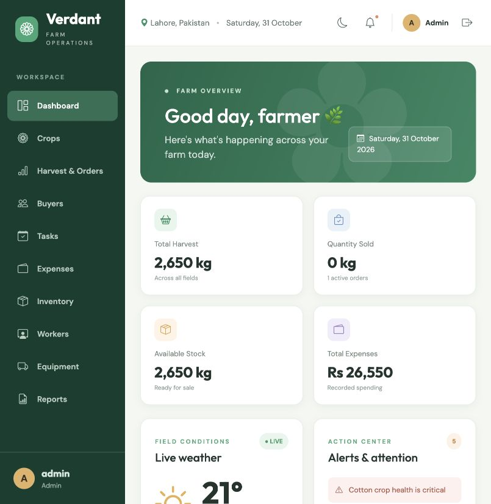

# Verdant — Agriculture Management System

Full-stack U Devs Batch 6 agriculture management application. The existing React + Redux frontend now uses an Express API, Sequelize, and PostgreSQL for farm records; Open-Meteo provides live weather. No Firebase or third-party application database is used.

## Features

- Protected JWT login/logout, Manager signup, Admin and Manager authorization enforced by the API.
- Dashboard analytics, crop health, harvest and order summaries, alerts, humidity and Open-Meteo forecast.
- Crops, harvest orders, buyers, farm tasks, expenses/profit, inputs inventory, workers, daily attendance, wages, equipment, maintenance, reports, CSV/PDF export, and audit activity.
- CNIC and phone validation; duplicate CNIC/attendance prevention; buyer JPG/PNG upload with a 1 MB limit; stock checks under a database transaction.
- Monthly wages calculated from attendance: Present = 1 day, Half-day = 0.5 day, Absent/Leave = 0 days; each payable day is multiplied by the worker’s daily wage. Payment creates one linked Labour expense.
- Maintenance entries update equipment service dates and create or update one linked Fuel or Repair expense.
- Manager can view and add records. Admin can view, add, edit, delete, and manage users. API authorization returns HTTP 403 for restricted Manager edits/deletes.
- Responsive React UI, role-aware actions, dark mode, toast feedback, reusable forms/tables, charts, filters, and confirmation dialogs.

## Technology

**Frontend:** React functional components/hooks, Redux Toolkit, React-Redux, Redux Thunk, React Router, Axios, Bootstrap, Chart.js, Vite, Open-Meteo.

**Backend:** Node.js, Express, PostgreSQL, Sequelize, bcryptjs, JWT, Multer, Helmet, CORS, express-rate-limit, Morgan.

## Screenshot



## Requirements

- Node.js LTS and npm
- PostgreSQL 14 or later (pgAdmin is optional)
- Git

Create a PostgreSQL database named `agriculture_management` and a database user/password. The examples below use that database name; set your own credentials in `backend/.env`.

## Setup and run

### 1. Backend and database

```bash
cd backend
npm install
cp .env.example .env
```

Edit `backend/.env` with PostgreSQL credentials and a long random `JWT_SECRET`. The `.env` file is ignored by Git.

```bash
npm run test:db       # verify PostgreSQL connectivity
npm run seed          # create demo accounts and sample farm records
npm run dev           # API on http://localhost:5000
```

The API synchronizes Sequelize models at startup. `npm start` runs the same server without nodemon.

### 2. Frontend

In a second terminal:

```bash
cd frontend
npm install
cp .env.example .env
npm start
```

Open <http://localhost:5173>. Set `VITE_API_URL` to the API base URL if it differs from `http://localhost:5000/api`. The weather city, coordinates, and refresh period are configured centrally through the other `VITE_WEATHER_*` values in `frontend/.env`.

### Demo accounts

Seed these accounts into the database with `npm run seed` from `backend/`:

| Role | Username | Password |
| --- | --- | --- |
| Admin | `admin` | `Admin@123` |
| Manager | `manager` | `Manager@123` |

Signup creates a Manager account. Change demo passwords before using a publicly accessible deployment.

## API reference

All endpoints are under `/api`. Protected routes require `Authorization: Bearer <JWT>`. Success responses use `{ "succeeded": true, "message": "...", "data": ... }`; errors include a message and HTTP status.

| Resource | Routes | Manager | Admin |
| --- | --- | --- | --- |
| Authentication | `POST /users/register`, `POST /users/login`, `GET /users/me`, `POST /users/logout` | Register/login/session | Register/login/session |
| Users | `GET /users`, `GET /users/:id`, `POST /users`, `PUT /users/:id`, `DELETE /users/:id` | No access | Full access |
| Crops, orders, buyers, tasks, expenses, inventory, workers, attendance, equipment, maintenance | `GET /:resource`, `GET /:resource/:id`, `POST /:resource`, `PUT /:resource/:id`, `DELETE /:resource/:id` | View and add | Full access |
| Buyers | `POST/PUT /buyers` multipart form, photo field `photo` | View and add | Full access |
| Inventory usage | `POST /inventory/:id/usage` | Record usage | Record usage |
| Wage payment | `POST /expenses/pay-wages` with `{ workerId, month }` | Pay wages | Pay wages |
| Activity | `GET /activity` | Read | Read |
| Health | `GET /health` | Public | Public |

Each resource’s update and delete endpoints are Admin-only and return 403 to Managers. Buyer photo files are served from `/images/<filename>`.

## Redux state and data flow

```text
Redux store (frontend/src/app/redux)
├── user       authenticated session and request states
├── crops      crop records and request states
├── orders     order records and request states
├── buyers     buyer sales and request states
├── tasks      farm tasks and request states
├── expenses   expenses and wage payments
├── inventory  inputs and usage history
├── workers    labour records
├── attendance daily records
├── equipment  machinery
├── maintenance service records
├── activity   audit history
├── weather    live forecast state
├── alerts     alert state
└── ui         theme, toast, sidebar
```

**Data flow:** React event → Redux Thunk → module Axios API → Express route → JWT/role middleware → controller and Sequelize model → PostgreSQL → standard JSON response → REQUEST/SUCCESS/FAILURE reducer update → selectors derive dashboard/report values → React render. Redux DevTools are enabled. The persistence middleware stores only the JWT session and theme in localStorage; application records remain in PostgreSQL. The Axios interceptor attaches the session token and clears expired sessions on HTTP 401. Activity is logged by the API with the authenticated username and timestamp.

## Tests and quality checks

Run frontend commands inside `frontend/`:

```bash
npm test
npm run lint
npm run build
```

Run backend commands inside `backend/`:

```bash
npm run test:db
npm test
```

The backend test suite uses the configured PostgreSQL database and exercises signup/login, JWT protection, Admin/Manager permissions, CRUD, buyer uploads and stock checks, duplicate attendance, wage calculation/expense linking, maintenance expense synchronization, overdue tasks, inventory usage, and activity attribution.

## Repository layout

```text
frontend/   React + Redux application
backend/    Express API, Sequelize models, migrations-by-sync, seed, and integration tests
README.md   Setup, architecture, and API guide
```

Never commit `.env`, PostgreSQL credentials, JWT secrets, `node_modules`, build output, or uploaded buyer photos. Use `.env.example` as a template. Screenshots are kept in the repository for the assignment review.

## Assignment

U Devs Batch 6 — Backend Development Guide. Developer: Haris Tariq.
# Complete-Agriculture-Management-System-
