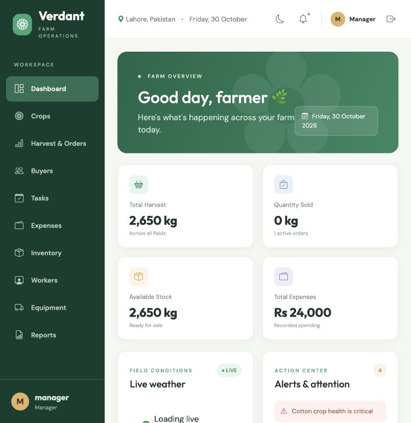

# Verdant — Agriculture Management System

Front-end only farm operations dashboard for U Devs Batch 6 (Extended v2). Built with React, Redux Toolkit, React-Redux, Redux Thunk, React Router, Bootstrap, Chart.js, Axios and browser localStorage. No server, database or Firebase is required.

## Run

```bash
npm install
npm start
```

Open `http://localhost:5173`. Run checks with `npm test`, `npm run lint` and `npm run build`.

### Demo credentials

| Role | Username | Password |
| --- | --- | --- |
| Admin | `admin` | `Admin@123` |
| Manager | `manager` | `Manager@123` |

These credentials are demo data in a client-only application, not secure authentication. Use synthetic data only. The initial records are clearly demo records and persist to `agri_*` localStorage keys on first load. Clear those keys to reset the demo.

## Features and checklist

- [x] Protected login, logout, Admin and Manager session
- [x] Dashboard with Open-Meteo weather, humidity, five-day forecast, alerts, charts and KPIs
- [x] Crop, order, buyer, task, expense, inventory, worker, attendance, equipment and maintenance CRUD flows
- [x] CNIC formatting, duplicate CNIC validation, phone/wage/quantity validation, buyer image preview and Base64 persistence
- [x] Crop stock calculation derived from harvest and buyer sales, including updates and deletions
- [x] Daily attendance duplicate prevention and monthly wage calculation
- [x] Wage and maintenance expenses with stable linked IDs to prevent duplication
- [x] Service due calculation, workforce/equipment dashboard indicators and alerts
- [x] Search, status filter, amount sort, CSV export and print/PDF from reports
- [x] Activity log with user, action, entity and timestamp
- [x] Responsive sidebar, tables, forms, confirmation modal and toast
- [x] Unit tests for validation, stock limit, attendance, wages and linked expenses

### Known limitations

The delivered interface uses a reusable CRUD component rather than every component file named in sections 8–9 of the brief. Several exact component file names are incomplete; the shared CRUD component supplies those flows. Demo authentication is necessarily client-side and cannot resist a user who edits localStorage or JavaScript. GitHub and Slack submission are not part of this repository and have not been performed.

## Screenshot



## Architecture

```
store
├── user         session, roles, login flags
├── crops        crop list and operation flags
├── orders       order list and operation flags
├── buyers       sales list and operation flags
├── weather      status, data, lastUpdated, error
├── tasks        task list and operation flags
├── expenses     expense list and operation flags
├── inventory    item list and operation flags
├── workers      worker list and operation flags
├── attendance   daily records and operation flags
├── equipment    machinery list and operation flags
├── maintenance  service list and operation flags
├── alerts       alert state
├── activity     audit records
└── ui           theme, toast, sidebar
```

Each data module has `src/app/redux/actions/<module>/index.js`, `api/<module>/index.js`, and `reducers/<module>/index.js`. Actions dispatch `REQUEST`, await a promise-based API response, and dispatch `SUCCESS` or `FAILURE`. Reducers update the corresponding list and operation flags. API calls use `storageApi` and safe localStorage access. `activityLogger` records changes with the logged-in user; `persistMiddleware` writes session, theme and data. Selectors calculate stock, alerts, wages, service dates, profitability and dashboard metrics. Redux DevTools are enabled.

**Data flow:** Save click → dispatch thunk → REQUEST → API reads/writes localStorage → SUCCESS/FAILURE → reducer updates state → selectors recalculate → React renders. Persistence and audit middleware run alongside successful actions.

## Configuration

Weather coordinates, display city and refresh interval are in `src/config.js`. Open-Meteo is the only live network dependency. The weather panel retains an error state if offline.

## Testing

`npm test` exercises 20 critical calculations, validations, storage cases and module CRUD flows. `npm run lint` checks source syntax and undefined names. `npm run build` produces `dist/`. A browser smoke test covered Admin and Manager login, live weather success, crop add/delete and confirmation, reload persistence, Manager equipment restrictions and all route rendering. Other interactive flows were not fully verified in a browser.

## Assignment

U Devs Batch 6. Developer: Haris Tariq.
